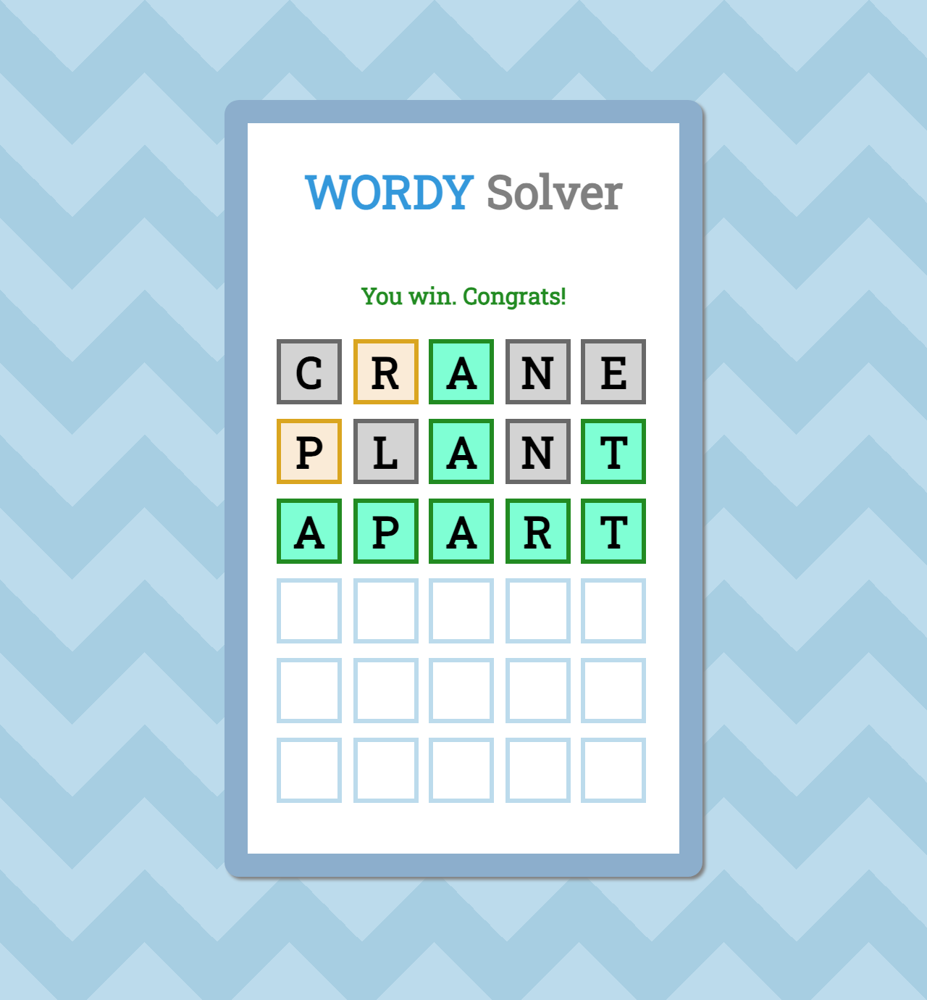

# Wordy Solver

A Wordle clone in plain HTML, CSS and JavaScript, with no framework or build step, made as a web development practice project. It fetches the word of the day from `words.dev-apis.com`, takes guesses from the keyboard, checks each guess against the same API's word validator, and scores letters in two passes so a repeated letter isn't marked "close" more than once. CSS custom properties drive the styling, down to the pulsing cursor on the active tile.

A pre-AI project from 2023.



## Run it locally

Serve the folder with any static server and open it in a browser, for example:

```sh
python3 -m http.server 8000
```

then go to http://localhost:8000 and start typing.
